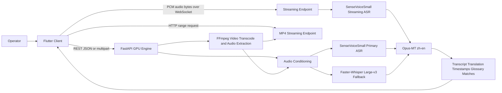
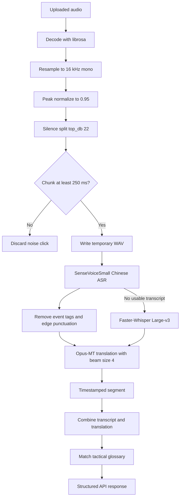
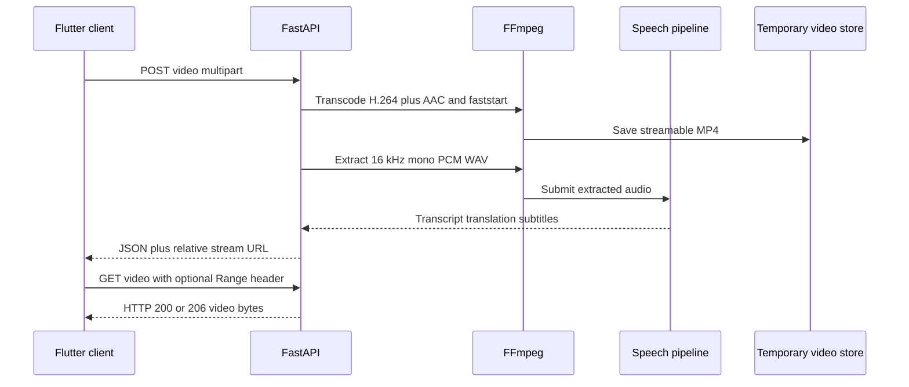
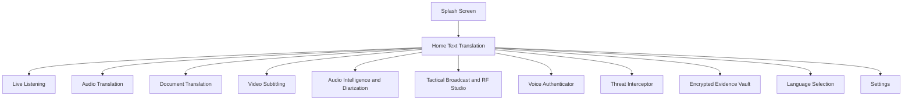
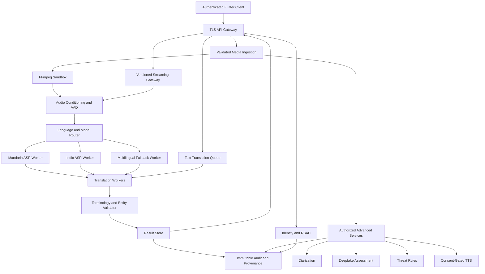

# Bhasha AI: Architecture, Models, Implementation, and Evaluation of a Tactical Multimodal Speech Translation Platform

**Project technical research report**  
**Repository assessment date:** 7 October 2026  
**System version observed:** Flutter application 1.0.0+1 and FastAPI GPU Engine 3.0.0

## Abstract

Bhasha AI is a prototype multimodal language-intelligence platform centered on noisy Mandarin radio communication. Its verified core accepts text, audio, live microphone data, and video; applies audio normalization and voice-activity detection; performs automatic speech recognition; translates recognized Chinese into English; and returns time-aligned results to a cross-platform Flutter client. The checked-in runtime uses Alibaba FunAudioLLM SenseVoiceSmall as its primary Chinese speech recognizer, Helsinki-NLP Opus-MT for Chinese-to-English translation, and Faster-Whisper Large-v3 as a fallback recognizer. A separate offline script evaluates Hugging Face Whisper Large-v3 with Opus-MT. The repository also contains benchmark artifacts for Qwen3-ASR, a LoRA fine-tuned Qwen3-ASR variant, Qwen2.5-Instruct, NLLB-200, and Whisper, plus design material for IndicConformer, IndicTrans2, Qwen2.5 7B, document OCR, speech synthesis, diarization, deepfake detection, threat detection, and an encrypted evidence vault.

This report distinguishes four evidence levels: capabilities implemented in the checked-in backend, client features integrated with those endpoints, benchmark-only model experiments, and proposed or demonstration-only modules. That distinction is important because the Flutter client exposes a broader tactical suite than the current Python server implements. The core Mandarin audio and video pipeline is executable and technically coherent, but the current translation router does not provide true general multilingual translation, the WebSocket protocol assumes each received byte message is a complete decodable audio file, and multiple advanced screens silently substitute canned data when their backend endpoints are unavailable. The 50-file evaluation corpus contains 762 detected speech chunks and complete transcripts, translations, and reference gists for every file. Existing benchmark results show that fine-tuning reduces repetition and improves output completeness, although the base Qwen3 pipeline records slightly higher domain-keyword recall than the fine-tuned system. The project is therefore best characterized as a validated tactical speech-translation prototype with a strong user-interface concept, a functional Mandarin core, and a clearly identifiable path toward production hardening.

**Keywords:** automatic speech recognition, neural machine translation, tactical communications, SenseVoiceSmall, Whisper Large-v3, Opus-MT, Qwen3-ASR, Flutter, FastAPI, voice activity detection, multilingual AI

## 1. Introduction

Operational radio recordings are difficult inputs for conventional speech systems. They contain silence, push-to-talk gaps, radio static, low signal levels, compressed speech, overlapping turns, local names, vehicle terminology, numbers, and chainage markers such as `K14+600`. In such environments, an error is not merely grammatical: confusing a loader with another vehicle, dropping a location marker, or hallucinating speech during dead air can change the operational meaning.

Bhasha AI addresses this problem with a staged local pipeline and a mobile-oriented interface. The backend conditions the audio before recognition, selects a primary or fallback ASR path, performs neural translation, attaches timestamps and glossary matches, and returns structured JSON. The frontend offers text, recorded speech, audio-file, document, and video workflows alongside a broader tactical suite for audio intelligence, content generation, authentication, threat scanning, and evidence storage.

The central conclusion of this repository assessment is that the project has two different boundaries:

1. The **implemented core** is a Mandarin-focused speech and video translation service with live-streaming support.
2. The **product vision** is a multilingual, air-gapped, three-leg platform for intelligence extraction, content generation, and voice authentication.

The code, tests, datasets, and research artifacts support the first boundary directly. The second boundary is represented substantially in UI flows and design documents, but several corresponding backend services and models are not included in this repository.

## 2. Objectives and Research Questions

The project aims to provide rapid, locally deployable interpretation of degraded communications while preserving timestamps, operational entities, and user access across multiple media types. This report evaluates the project through five questions:

1. What end-to-end workflows are implemented in the repository?
2. Which models are used at runtime, evaluated experimentally, or only proposed in architecture material?
3. How do the Flutter frontend, FastAPI backend, model pipeline, and deployment bridge interact?
4. What do the 50-audio benchmark artifacts establish about recognition and translation quality?
5. What technical work is required to convert the prototype into a secure and reproducible production system?

## 3. Repository Scope and Evidence Method

The assessment covers the complete project workspace: two Python entry points, the Flutter application, 50 MP3 recordings, manually prepared reference translations, JSON/XLSX/Markdown evaluation results, benchmark PDFs, a presentation, and the RANNVAANI-NSVD concept document.

Claims in this report use the following hierarchy:

| Evidence level | Meaning | Examples in this project |
| --- | --- | --- |
| Runtime implemented | Present in executable Python backend code | SenseVoiceSmall, Opus-MT, Faster-Whisper, VAD, REST audio/video APIs |
| Client integrated | Flutter sends requests to a named endpoint and renders a result | text/audio/video translation, live microphone streaming |
| Benchmark evaluated | Model appears in stored comparative results but not in the checked-in production server | Qwen3-ASR, LoRA Qwen3-ASR, Qwen2.5-3B-Instruct, NLLB-200 600M |
| Designed or demonstrated | Described in documents or represented by a client fallback, without a matching checked-in server implementation | IndicConformer, IndicTrans2, Qwen2.5 7B gist, diarization, deepfake detection, AES vault |

This classification prevents architecture claims from being mistaken for deployable code.

## 4. System Overview

### 4.1 Logical architecture



The system follows a thin-client architecture. Flutter manages interaction, local UI state, file selection, microphone capture, playback, and rendering. The Python service owns model inference and media conversion. The remote deployment helper creates an SSH tunnel from a local machine on port 8000 to a GPU server, allowing a phone on the same network to reach the service through the local host.

### 4.2 Physical deployment

```mermaid
flowchart TB
    M[Android iOS Web or Desktop Flutter Client]
    L[Local Workstation 0.0.0.0 port 8000]
    G[Remote GPU Host 172.16.136.120 SSH port 8026]
    B[FastAPI and Model Process 127.0.0.1 port 8000]
    T[/tmp/bhasha_videos]

    M -->|HTTP WS cleartext in current config| L
    L -->|SSH local port forwarding| G
    G --> B
    B --> T
```

`run_backend.sh` establishes the tunnel and invokes a second runner on the remote host. The remote runner is referenced but is not included in this workspace. The Android manifest permits Internet access, microphone recording, media access, legacy external storage, and cleartext traffic.

## 5. End-to-End Processing Method

### 5.1 Audio-file workflow



The preprocessor loads the signal through `librosa`, resamples it to 16 kHz mono, scales the peak amplitude to 0.95, and applies energy-based splitting with `top_db=22`, a frame length of 2048, and a hop length of 512. Chunks shorter than 250 ms are excluded. If no interval survives, the entire non-empty signal becomes a single chunk.

SenseVoiceSmall runs with Chinese as the requested language, inverse text normalization enabled, and merged VAD disabled. The service removes model tags such as acoustic-event markers before translation. Chinese text is segmented at punctuation or approximately 70 characters, tokenized with a 512-token maximum, and decoded through Opus-MT using four-beam search.

### 5.2 Fallback behavior

The server invokes Faster-Whisper only when the SenseVoice path produces no transcript. It uses beam size 5, its own VAD filter, and a 400 ms minimum-silence parameter. The code computes whether the output contains Chinese characters and labels the language as either “Chinese (Mandarin)” or the generic “Detected Audio.” It does not expose Whisper's detected language name.

The text translation router is narrower than its name suggests. For target English, it always applies the Chinese-to-English Opus-MT model. For any other target language, it returns the input unchanged. This means that the backend's advertised language list and the Flutter language picker exceed the actual language pairs implemented by the checked-in server.

### 5.3 Video workflow



Video is transcoded to H.264 with YUV420p, AAC audio, CRF 24, the ultrafast preset, and `faststart`. The audio track is converted to 16-bit 16 kHz mono WAV and processed by the same audio pipeline. The resulting MP4 is stored under `/tmp/bhasha_videos` and supports byte-range streaming. No retention policy or cleanup job is implemented for the transcoded files.

### 5.4 Live microphone workflow

The Flutter client records 16 kHz mono PCM16 audio and forwards chunks through `/ws/audio/stream`. The server writes every received WebSocket byte message to a temporary `.wav` file, sends it to SenseVoiceSmall, translates the text with Opus-MT, and returns a partial result.

There is a protocol-level risk: raw PCM chunks do not normally contain a WAV header, while the server saves each chunk with a `.wav` suffix and treats it as a complete audio file. A production stream should use framed PCM with explicit sample metadata and an in-memory decoder, or send self-contained WAV frames. The client also sends a JSON flush message through a socket that the server reads only with `receive_bytes`, so the flush path is not protocol-compatible.

## 6. Model and Engine Inventory

### 6.1 Models present in executable code

| Model or engine | Origin or implementation | Repository role | Status |
| --- | --- | --- | --- |
| `iic/SenseVoiceSmall` | Alibaba FunAudioLLM through FunASR | Primary Chinese ASR for file, video, and WebSocket paths | Implemented in GPU server |
| `Helsinki-NLP/opus-mt-zh-en` | Marian sequence-to-sequence model through Transformers | Chinese-to-English neural translation | Implemented in both Python paths |
| Faster-Whisper `large-v3` | CTranslate2-based Whisper implementation | Fallback ASR when SenseVoice returns no transcript | Implemented in GPU server |
| `openai/whisper-large-v3` | Hugging Face Transformers | Direct Chinese transcription and direct English translation in offline CLI | Implemented in offline script |
| FFmpeg H.264 and AAC codecs | System executable | Video normalization, web-compatible encoding, and audio extraction | Implemented external dependency |
| librosa energy splitting | Python signal-processing library | Resampling, normalization, and speech-interval detection | Implemented preprocessing |

The standalone `transcribe_translate.py` script uses a Chinese domain prompt containing construction, vehicle, radio, blasting, location, wall, and transformer vocabulary. It produces a Chinese transcript, a direct Whisper English translation, an Opus-MT English translation, and timestamps. This script is separate from the production FastAPI service and does not use SenseVoice.

### 6.2 Models present in benchmark artifacts

| Experimental pipeline | ASR | Translation | Repository evidence |
| --- | --- | --- | --- |
| Base Qwen pipeline | Qwen3-ASR-1.7B | Qwen2.5-3B-Instruct | 50-file comparative benchmark PDF |
| Fine-tuned Qwen pipeline | Qwen3-ASR with LoRA | Qwen2.5-3B-Instruct | Benchmark PDF; described as GPU4 fine-tuning |
| Whisper baseline | Whisper Large-v3 | Direct Whisper translation | Benchmark PDF and evaluation report |
| Literal NMT pipeline | Qwen3-ASR-1.7B | NLLB-200 600M | Benchmark PDF |

These model loaders, checkpoints, fine-tuning scripts, LoRA adapters, prompt templates, and inference services are not present in the checked-in Python backend. Their results should therefore be treated as experimental artifacts rather than the current runtime.

### 6.3 Models and components in architecture documents but not in runtime code

| Proposed component | Intended role | Checked-in status |
| --- | --- | --- |
| IndicConformer | ASR specialized for Indian languages | Named in model/workflow PDF and client comments only |
| IndicTrans2 | Translation among English and 22 scheduled Indian languages | Named in model/workflow PDF and client comments only |
| Qwen2.5 7B multilingual | Context-aware translation and tactical gist generation | Named in model/workflow PDF and UI comments; endpoint missing |
| TIH Acoustic Matcher | Fast acoustic checksum lookup | Described in PDF; no implementation found |
| Universal Neural NMT | Rare-language fallback | Client instead uses an unauthenticated Google Translate web endpoint for text |
| Neural multilingual TTS | Speech synthesis | Client calls `/api/tts`; server route missing |
| Male and tactical-radio DSP | Voice profile and radio-channel simulation | UI configuration exists; backend DSP absent |
| PyMuPDF and Tesseract | PDF and image OCR | Described in PDF; not imported or used |
| Speaker diarization and voiceprints | Separate speakers and extract identities | Client endpoint and fallback data only |
| Deepfake detector | Classify real versus synthetic speech | Client endpoint and fallback forensic scores only |
| AES-256-GCM vault and SHA-256 integrity | Secure evidence storage | UI and fallback records only; no server storage or cryptography |

### 6.4 Tactical glossary

The server contains a fixed Chinese-to-English glossary covering loaders, excavators, tankers, flatbeds, tipper trucks, concrete plants, retaining walls, ditches, stone blocks, blasting, drilling, fuel barrels, hand-held radio sets, transformers, named individuals, and Lhasa. The runtime currently uses this mapping only to report matched terms. It does not substitute glossary terms into the translation decoder or post-edit the translated output, despite design documents describing glossary-injected NMT.

## 7. Backend Architecture

### 7.1 Technology stack

The server is a single Python process built with FastAPI and Pydantic. PyTorch provides device selection and model execution. FunASR loads SenseVoiceSmall, Transformers loads Opus-MT, Faster-Whisper loads Whisper Large-v3, librosa and NumPy handle signal preprocessing, SoundFile writes temporary WAV chunks, and FFmpeg is invoked through the operating system for video conversion.

Models are loaded at module import. Each load is independently wrapped in an exception handler, allowing the service to start with a partial model set. The `/health` endpoint exposes the device, allocated GPU memory, active model keys, a fixed latency field, and an advertised language list.

### 7.2 Implemented API surface

| Method and path | Input | Output | Implementation status |
| --- | --- | --- | --- |
| `GET /health` | None | Device, model list, GPU allocation, languages | Implemented |
| `POST /api/translate/text` | JSON text and language codes | Source and translated text, latency | Implemented but only zh-to-en translation is real |
| `POST /api/translate/audio` | Multipart audio and form options | Transcript, translation, glossary matches, subtitle segments | Implemented |
| `POST /api/translate/video` | Multipart video and form options | Transcript, translation, subtitle segments, stream URL | Implemented |
| `GET /api/stream/video/{video_id}` | Optional HTTP Range header | MP4 full or partial response | Implemented |
| `WS /ws/audio/stream` | Binary messages | Incremental source and translated text | Implemented with framing limitations |

The server accepts `source_lang` and `noise_reduction` in audio and video forms but does not use either value in processing. It always reports `source_lang` as `auto`. The client also submits a `use_indic` field that the server does not declare.

### 7.3 Client endpoints without matching server routes

| Client request | Intended feature |
| --- | --- |
| `/api/generate/gist` | Tactical summary |
| `/api/audio/denoise` | Spectral or Wiener noise reduction |
| `/api/audio/diarize` | Speaker diarization and voiceprints |
| `/api/tactical/generate_script` | Scenario-based broadcast script |
| `/api/audio/apply_acoustic_fx` | Radio or telephone acoustic profile |
| `/api/tts/clone` | Voice cloning and synthesis |
| `/api/tts` | General translated speech playback |
| `/api/auth/deepfake_detect` | Voice authenticity classification |
| `/api/threat/scan` | Text keyword and threat detection |
| `/api/threat/scan_audio` | Audio threat detection |
| `/api/vault/records` | Evidence listing |
| `/api/vault/archive` | Evidence encryption and storage |
| `/api/vault/verify` | Hash and integrity verification |

When these requests fail, `GpuApiService` commonly returns realistic-looking static data with `status: success`. This keeps demonstrations navigable but makes unavailable services appear operational. Production behavior should return an explicit unavailable or offline state and visibly mark sample data.

### 7.4 Backend reliability and security observations

- CORS allows every origin while credentials are enabled. Production deployment should use an explicit origin list.
- File uploads are read entirely into memory, with no configured size limit or MIME verification.
- Temporary upload and chunk files are removed, but transcoded videos persist in `/tmp/bhasha_videos`.
- FFmpeg commands are constructed as shell strings and executed with `os.system`. Random server-side temporary paths reduce exposure, but `subprocess.run` with an argument list is safer and provides reliable error handling.
- Model-loading failures are logged but do not change health status from `online`.
- The API reports fixed minimum latency and a fixed `confidence: 0.99`; these are presentation values, not measured model confidence.
- Exceptions in Whisper fallback are silently discarded, making diagnosis difficult.
- No authentication, authorization, transport-layer security, audit logging, rate limiting, or persistent database is present in the checked-in server.

## 8. Frontend Architecture

### 8.1 Framework and state management

The client is a Flutter Material 3 application targeting Android, iOS, web, Linux, macOS, and Windows. `Provider` exposes a single `AppState` object across the application. `AppState` coordinates language selection, server configuration, connection status, text translation, file workflows, microphone streaming, speech playback, and presentation models.

Key dependencies are:

| Package | Role |
| --- | --- |
| `provider` | ChangeNotifier-based application state |
| `http` | REST and multipart requests |
| `web_socket_channel` | Live audio WebSocket |
| `file_picker` | Audio, video, and document selection |
| `record` | PCM microphone capture |
| `audioplayers` | TTS and processed-audio playback |
| `video_player` | Local and streamed video playback |
| `shared_preferences` | Included dependency; no repository usage was found |
| `intl` | Formatting support |

The theme uses a light Material interface with coral-red primary accents, neutral surfaces, dark pill buttons, and green connection indicators.

### 8.2 Navigation and screens



The home screen is the central translation surface and attachment launcher. Audio and video screens show detected language, source text, translated text, latency, tactical matches or subtitles, copy controls, playback, and optional gist cards. The document screen supports multiple attached documents and per-page translations. The intelligence, broadcast, authenticator, threat, and vault screens form the advanced tactical suite.

### 8.3 Language handling

The general picker contains 20 languages. Indian Languages mode exposes English plus the 22 scheduled Indian languages represented by Assamese, Bengali, Bodo, Dogri, Gujarati, Hindi, Kannada, Kashmiri, Konkani, Maithili, Malayalam, Manipuri, Marathi, Nepali, Odia, Punjabi, Sanskrit, Santali, Sindhi, Tamil, Telugu, and Urdu.

The UI can switch target language and automatically retranslate attached text, audio, documents, and video. In the checked-in backend, however, non-English targets are returned unchanged. Text translation may fall back to an unofficial Google Translate web endpoint, and speech playback may fall back to Google Translate TTS. Those cloud fallbacks conflict with the architecture documents' claim of completely offline or air-gapped operation.

### 8.4 Document workflow

The document picker accepts PDF, TXT, DOCX, DOC, and Markdown. Only TXT and Markdown contents are actually read. Other formats receive a hard-coded tactical operating-procedure paragraph. At most the first six non-empty lines are translated and are labeled as pages. Consequently, the current UI demonstrates a page-oriented workflow but does not implement PDF parsing, Word extraction, OCR, layout preservation, or translated overlays.

### 8.5 Connection discovery and failure behavior

The API client starts with `192.168.0.141:8000` and sequentially probes a list that includes another LAN address, the remote GPU address, the Android emulator host, and localhost. Successful probes replace the active host. Text calls use the configured server first and then a public Google endpoint. Audio and video calls retry candidate hosts. Several failed workflows return successful sample objects rather than errors. This design favors uninterrupted demos but weakens operational truthfulness and observability.

## 9. Data Models and Contracts

The frontend uses explicit objects for translated text, audio attachments, document pages, video media, and live segments.

| Model | Principal fields |
| --- | --- |
| `TranslationResult` | source text, translated text, gist, language codes, detected language, latency, confidence, tactical matches, live segments, timestamp |
| `AudioFileTranslation` | file identity, path, duration, source and translated text, gist, languages, latency, confidence, matches |
| `DocumentTranslation` | file name, page count, elapsed seconds, list of pages |
| `DocumentPage` | page number, original text, translated text, confidence |
| `VideoMediaTranslation` | title, local path, stream URL, duration, progress, language, full texts, gist, latency, subtitles |
| `VideoSubtitle` | display timestamp, original and translated text, numeric start and end |
| `LiveSegment` | source text, translated text, detected language |

There is one important contract mismatch: `TranslationResult.fromJson` looks for `segments`, while the audio backend returns timestamped items under `subtitles`. The audio attachment still receives the full source and translated text, but its structured segment list is not populated from that response.

## 10. Dataset and Evaluation Design

### 10.1 Corpus

The dataset consists of 50 MP3 radio or field-communication recordings totaling approximately 55 MB. The reference file supplies English operational gists rather than word-for-word Chinese transcripts. The conversations cover construction logistics, vehicle movements, loaders, excavators, tankers, concrete, retaining walls, road clearing, drilling, blasting, chainage markers, safety instructions, equipment, and named personnel.

The enhanced JSON result set contains:

| Measure | Observed value |
| --- | ---: |
| Audio files | 50 |
| Detected speech chunks | 762 |
| Mean chunks per file | 15.24 |
| Median chunks per file | 14.5 |
| Minimum and maximum chunks | 1 and 42 |
| Files with detected entities | 25 |
| Entity mentions | 32 |
| Files with detected codenames | 14 |
| Codename mentions | 24 |
| Files with non-empty transcript | 50 |
| Files with non-empty translation | 50 |
| Files with non-empty reference gist | 50 |
| Reported enhanced processing time | 109.50 seconds |
| Derived mean processing time | 2.19 seconds per file |

The enhanced results were produced with SenseVoiceSmall, peak normalization, VAD-based silence elimination, and Opus-MT. A separate comparative PDF evaluates Qwen3 and Whisper pipelines against the same reference gists.

### 10.2 Benchmark metrics

| Pipeline | Domain keyword recall | Repetition-loop rate | Output completeness | Mean output length |
| --- | ---: | ---: | ---: | ---: |
| Fine-tuned Qwen3-ASR plus Qwen2.5 | 30.4% | 14.0% (7/50) | 86.0% | 386.5 characters |
| Base Qwen3-ASR plus Qwen2.5 | 34.0% | 20.0% (10/50) | 80.0% | 415.3 characters |
| Whisper Large-v3 direct | 15.2% | 36.0% (18/50) | 64.0% | 524.2 characters |
| Base Qwen3-ASR plus NLLB-200 | 16.2% | 52.0% (26/50) | 48.0% | 582.9 characters |

The fine-tuned Qwen system has the best repetition and completeness results, but not the highest reported domain-keyword recall; the base Qwen3 plus Qwen2.5 pipeline leads that metric by 3.6 percentage points. Therefore, the benchmark supports a trade-off conclusion rather than dominance on every measure.

### 10.3 Interpretation limits

The reference is an operational English gist, while most system outputs are longer transcript-like translations. Standard word error rate cannot be meaningfully calculated without verified Chinese transcripts, and translation metrics such as BLEU are sensitive to the mismatch between verbatim translation and summary-style references. The stored benchmark uses domain recall, repetition, completeness, and output length, but the repository does not include metric-calculation code, annotations, inter-rater agreement, confidence intervals, or a held-out split.

Qualitative examples show that Whisper can repeat phrases over static or silence and that domain models can preserve numbers, locations, and equipment better. The enhanced SenseVoice/Opus outputs also contain conspicuous semantic errors in difficult files, demonstrating that successful chunk detection is not equivalent to operationally reliable meaning.

## 11. Verification Results

Verification performed against the checked-in source produced the following results:

| Check | Result |
| --- | --- |
| Python syntax compilation for both entry points | Passed |
| Flutter static analysis | Passed with no issues |
| Flutter widget and feature tests | 2 passed, 1 failed |
| Failing test | Attachment sheet expected the label `Translate Media / File`, but no matching widget was found |

The tests verify application rendering, splash-to-home navigation, sample audio/document/video state, and the presence of attachment workflows. They do not exercise real HTTP requests, model inference, WebSocket audio, FFmpeg conversion, security behavior, or benchmark reproducibility. The feature test also triggers asynchronous retranslation after a language change without asserting the translated result.

## 12. Performance and Scalability

The architecture specification reports the following measurements on an NVIDIA A100-SXM4-80GB system for 30 seconds of audio: 15–30 ms for conditioning and VAD, 200–250 ms for SenseVoice recognition, 20–50 ms for Opus-MT, and under 350 ms end to end. It also claims 50–100 concurrent radio channels and approximately 300 ms turnaround after a push-to-talk release.

These values are stored design or benchmark claims rather than measurements reproducible from this workspace. The current request path processes VAD chunks sequentially, runs translation segment by segment, writes temporary files, and uses synchronous model calls inside asynchronous FastAPI handlers. Under concurrent load, those choices can block the event loop and serialize GPU work. A production service should add a bounded inference queue, worker isolation, micro-batching where appropriate, model warm-up checks, per-stage timing, and load tests using representative file durations and concurrency.

## 13. Security, Privacy, and Responsible Use

The intended use involves sensitive communications, voice identity, surveillance-derived media, and potentially synthetic speech. That raises stronger requirements than a normal translation application.

### 13.1 Current security posture

The included code can be deployed behind an SSH tunnel and performs model inference locally, but it is not yet an air-gapped security boundary. The mobile connection uses cleartext HTTP and WebSocket by default. CORS is unrestricted. There is no user identity, role model, API token, certificate validation, evidence database, encrypted storage, deletion policy, or audit trail. The client can call public Google translation and TTS endpoints. Advanced vault claims are represented by fallback values rather than cryptographic operations.

### 13.2 Required controls

- Use TLS or mutually authenticated TLS between client and inference gateway.
- Remove cloud fallbacks in air-gapped mode and make network policy explicit.
- Add authentication, role-based authorization, rate limits, and immutable audit events.
- Enforce file-size, type, codec, duration, and decompression limits before decoding.
- Encrypt stored media and metadata with managed keys and implement verified deletion.
- Separate synthetic-voice generation from authentication and require authorization, consent, watermarking, and provenance records.
- Preserve original evidence, derived artifacts, model versions, hashes, timestamps, and operator actions in a defensible chain of custody.
- Treat translation, threat, and deepfake scores as decision support, not autonomous conclusions.

## 14. Principal Limitations

1. **Multilingual coverage is overstated by the runtime.** The checked-in NMT model supports Chinese to English only; other targets are passed through unchanged.
2. **Advanced features lack matching backend routes.** Thirteen client routes for gist, intelligence, generation, authentication, threat, TTS, and vault operations are absent.
3. **Demonstration fallbacks look like real results.** Static success objects include confidence, forensic, threat, and cryptographic claims.
4. **Live-stream framing is fragile.** Raw PCM chunks are treated as complete WAV files, and the client/server flush message types do not match.
5. **Document translation is a UI prototype.** PDF, DOC, and DOCX files are not parsed; non-text files receive placeholder content.
6. **Reported confidence and latency are partly synthetic.** Audio confidence is fixed at 0.99 and latency values are forced to minimums.
7. **Evaluation lacks reproducible scoring code.** Benchmark tables exist, but scripts for generating metrics and fine-tuned checkpoints are absent.
8. **Model failure does not fail health.** The server can report online even when primary models did not load.
9. **Operational security is incomplete.** Cleartext local traffic, permissive CORS, public fallbacks, and missing authorization conflict with sensitive use.
10. **Resource lifecycle is incomplete.** Transcoded videos have no scheduled removal, quota, or ownership isolation.

## 15. Recommended Development Roadmap

### Phase 1: Make the core truthful and reproducible

- Add a locked Python dependency file, environment specification, model revision pins, FFmpeg version, and startup instructions.
- Replace silent fallbacks with typed errors and visibly labeled demo mode.
- Make `/health` return readiness only when required models load and add per-model status.
- Align response keys, especially `segments` versus `subtitles`.
- Validate file types and sizes and replace shell-based FFmpeg invocation.
- Add integration tests for every implemented route and a script that regenerates evaluation metrics.

### Phase 2: Stabilize streaming and multilingual translation

- Define a versioned WebSocket protocol with initialization metadata, PCM frames, acknowledgments, finalization, and errors.
- Buffer PCM by time or VAD state instead of treating every network message as a WAV file.
- Implement target-language routing with explicit supported pairs.
- Integrate IndicTrans2 and an Indian-language ASR only after storing their exact checkpoints, preprocessing, licensing, and quality tests.
- Remove Google fallbacks from offline mode.

### Phase 3: Implement advanced services as independent modules

- Build diarization, denoising, gist, threat scanning, TTS, deepfake detection, and evidence storage behind versioned APIs.
- Give each service a model card, calibration dataset, threshold rationale, failure modes, and acceptance tests.
- Require authenticated workflows and provenance for voice cloning and synthetic-content generation.

### Phase 4: Production hardening

- Containerize the gateway and model workers; add GPU-aware scheduling and bounded queues.
- Introduce TLS, identity, roles, secrets management, structured logs, metrics, tracing, and alerting.
- Add retention controls for uploads, generated media, transcripts, and evidence.
- Conduct load, adversarial-audio, dialect, noise, fairness, security, and recovery testing.
- Run a blinded human evaluation with multiple annotators and measure entity accuracy, number/location preservation, semantic adequacy, hallucination rate, and actionable-gist accuracy.

## 16. Proposed Production Architecture



This design keeps the proven speech path central while isolating higher-risk features. It also separates network handling from GPU inference, allows explicit queues and quotas, and ensures that evidence and model provenance are recorded alongside outputs.

## 17. Reproduction Guide

### 17.1 Offline CLI

The standalone command-line workflow expects PyTorch, Transformers, audio dependencies, and access to the Whisper and Opus-MT model files.

```bash
python3 transcribe_translate.py --audio "50 Audio files/1.mp3"
python3 transcribe_translate.py --dir "50 Audio files" --output output.json
```

### 17.2 GPU API

The API module starts Uvicorn on all interfaces at port 8000:

```bash
python3 bhasha_gpu_server.py
```

The runtime additionally requires FunASR, Faster-Whisper, Transformers, PyTorch, librosa, SoundFile, NumPy, FastAPI, Uvicorn, multipart support, and FFmpeg. No dependency lock file is included, so a reproducible deployment requires creating one and pinning compatible versions and model revisions.

### 17.3 Flutter client

```bash
cd bhasha_app
flutter pub get
flutter analyze
flutter test
flutter run
```

The server address can be changed through the settings interface. Android builds require microphone, network, and media permissions already declared in the manifest.

## 18. Conclusion

Bhasha AI demonstrates a credible approach to tactical speech translation: remove silence and normalize audio before recognition, use a noise-robust primary ASR model, retain Whisper as a fallback, translate with a lightweight local NMT model, and present timestamps and media playback through a cross-platform client. The repository provides a complete 50-file evidence set, a functional Mandarin core, and a broad interface for future intelligence workflows.

The project's main engineering challenge is no longer the UI concept. It is alignment between claims, endpoints, models, metrics, and operational behavior. The most valuable next step is to establish a truthful, versioned, reproducible core in which unsupported language pairs and services fail explicitly. Once that foundation is secure, the benchmarked Qwen pipeline, Indian-language stack, diarization, authentication, and evidence services can be added as independently validated modules. With that separation, Bhasha AI can progress from a strong research prototype to a defensible production system.

## References and Project Artifacts

1. `bhasha_gpu_server.py` — FastAPI GPU inference and media server.
2. `transcribe_translate.py` — offline Whisper Large-v3 and Opus-MT evaluation pipeline.
3. `bhasha_app/lib/` — Flutter client, state, services, screens, models, theme, and widgets.
4. `50 Audio files/Translation.docx` — English operational reference gists for the 50 recordings.
5. `results/translations_results.json` and `results/translations_report.md` — initial Whisper and Opus-MT outputs.
6. `results_enhanced/enhanced_translations.json` and `enhanced_translations_report.md` — SenseVoiceSmall and Opus-MT outputs with segmented timestamps.
7. `50_Audio_Files_ASR_Translation_Benchmark.pdf` — Qwen3, fine-tuned Qwen3, Whisper, and NLLB comparison.
8. `50_Audio_Files_Evaluation_Report.pdf` — ground-truth, custom-model, and Whisper comparison.
9. `Tactical_Speech_Translation_Architecture_Spec.pdf` — three-stage pipeline and performance specification.
10. `bhasha_ai_models_and_workflow.pdf` — extended model directory and intended multimodal workflow.
11. `RANNVAANI-NSVD –08 Sept.docx` — three-leg operational concept for intelligence, content generation, and voice authentication.

## Appendix A. Project Structure

```text
Bhasha AI/
├── bhasha_gpu_server.py
├── transcribe_translate.py
├── run_backend.sh
├── bhasha_app/
│   ├── lib/
│   │   ├── main.dart
│   │   ├── state/app_state.dart
│   │   ├── services/
│   │   ├── models/
│   │   ├── screens/
│   │   ├── widgets/
│   │   └── theme/
│   ├── test/
│   ├── android/ ios/ web/ linux/ macos/ windows/
│   └── pubspec.yaml
├── 50 Audio files/
│   ├── 1.mp3 ... 50.mp3
│   └── Translation.docx
├── results/
├── results_enhanced/
└── benchmark, architecture, and presentation artifacts
```

## Appendix B. Capability Status Matrix

| Capability | Frontend | Backend | Evidence quality |
| --- | --- | --- | --- |
| Text translation | Implemented | Partially implemented | Real for zh-to-en; cloud or pass-through otherwise |
| Audio-file transcription and translation | Implemented | Implemented | Core runtime capability |
| Video transcription, translation, and streaming | Implemented | Implemented | Core runtime capability |
| Live microphone translation | Implemented | Implemented with protocol risk | Requires framing correction |
| Tactical glossary match reporting | Rendered | Implemented | Match list only, not decoder injection |
| Document translation | Implemented UI | Placeholder extraction | Prototype |
| Tactical gist | Implemented UI | Missing route | Designed or demo-only |
| Denoising and diarization | Implemented UI | Missing routes | Designed or demo-only |
| Tactical script and voice cloning | Implemented UI | Missing routes | Designed or demo-only |
| Deepfake detection | Implemented UI | Missing route | Designed or demo-only |
| Threat scanning | Implemented UI | Missing routes | Designed or demo-only |
| Encrypted evidence vault | Implemented UI | Missing routes and storage | Designed or demo-only |
| Indian-language ASR and NMT | Language UI present | Models absent | Architecture-only in this repository |
| Qwen3 fine-tuned pipeline | No direct runtime integration | Server absent | Benchmark artifact |
